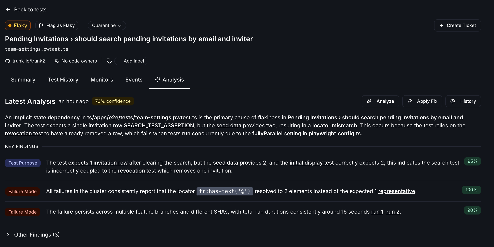

Trunk can investigate flaky tests in your codebase and help raise fix pull requests with suggested solutions.

## Prerequisites

To use the Autofix Flaky Tests feature, you'll need:

1. Beta access via waitlist (reach out to us at [support@trunk.io](mailto:support@trunk.io))
2. The **Investigate Flaky Tests** setting enabled on the repository, at **Settings** → **Repositories** → **[your repository]** → **General**
3. Active installation of the [Trunk GitHub App](../../setup-and-administration/github-app-permissions)

<Note>
**Investigate Flaky Tests** is a per-repository setting, and only organization admins can change it. Turning it off disables every kind of investigation for that repository, including ones you start by hand and ones started through MCP.
</Note>

<Frame>

</Frame>

## Investigate Flaky Tests

Start an investigation from a test's detail page in the Trunk app, or through the [MCP server](../reference/mcp-reference/fix-flaky-test). Trunk analyzes the failure patterns, failure output, and git history of the test to provide a number of insights.

<Frame>

</Frame>

### Investigation limits

Trunk caps how many investigations run through MCP, so an agent can't consume an unbounded amount of analysis. Two limits apply:

| Limit                                        | Default |
| -------------------------------------------- | ------- |
| Investigations per repository, per month      | 100     |
| Investigations per individual test, per month | 5       |

Both are counted per calendar month and reset on the first of the month. The per-test limit keeps a single test from consuming the whole repository's budget.

#### What counts against the limits

- **Investigations started through MCP**, using the [`fix-flaky-test`](../reference/mcp-reference/fix-flaky-test) tool with `createNewInvestigation: true`.

Only investigations that finish and produce a result are counted. One that fails or is skipped doesn't consume any of your budget.

#### What doesn't count

Investigations you start by hand from a test's detail page in the Trunk app are exempt from both limits. They never count against your budget, and you can still run them after a repository or test has hit its cap.

<Tip>
Both limits can be raised for your repositories. If you expect to run more investigations than the defaults allow — for example, driving fixes with an agent through MCP — contact us at [support@trunk.io](mailto:support@trunk.io) with the repositories you want raised and a rough estimate of your monthly volume.
</Tip>

### Skipped and failed analyses

When Trunk skips or fails an analysis, the Analysis tab shows a banner explaining what happened. Common reasons an analysis is skipped:

- **Monthly analysis limit reached.** The repository or the test has used all of its investigations for the current calendar month. See [Investigation limits](#investigation-limits). The banner shows how long ago the skip occurred.
- **Analysis already in progress.** A previous run is still queued; Trunk skips a new one to avoid duplicates.

If an analysis fails due to an internal error, the banner notes the failure without exposing internal details. In either case, you can request a new analysis once the blocking condition clears — and a manual analysis from the test's detail page is always available, even while a limit is reached.

## What's next?

- Continue to monitor your tests to confirm the flaky test fixes are effective
- Investigations can be triggered and applied via [MCP](../reference/mcp-reference/fix-flaky-test)

<Info>
**Coming soon.** Set up Claude Routines to autofix flaky tests
</Info>
