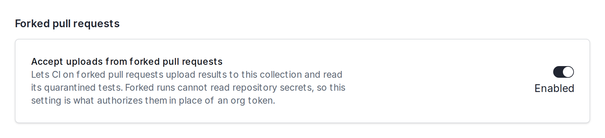
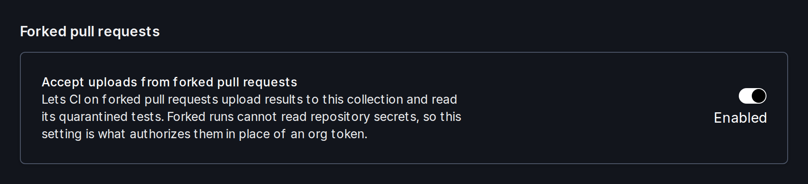

CI on a pull request from a fork can't use your Trunk API key. GitHub Actions workflows triggered by `pull_request` events from a fork run with read-only permissions and can't read repository secrets, so the secret that holds your API key is empty. Trunk lets these runs upload to a [test collection](../test-collections) without a key through an opt-in on the collection.

<Info>
This is intended for public repositories that accept outside contributions. For private repositories or forks inside your organization, keep using your API key.
</Info>

A forked run can also read quarantined tests, so [quarantining](../quarantining/) works on fork pull requests the same way it does on your own branches.

## 1. Enable forked pull request uploads on the collection

In the Trunk web app, open the collection, go to **Settings** → **Uploads**, and turn on **Accept uploads from forked pull requests**. Only organization admins can change this setting.

<Frame>
  
  
</Frame>

Trunk does not issue a separate identifier for this. The fork run addresses the collection by its [collection ID](../test-collections#the-collection-id), the same eight-character ID you already pass with `--test-collection-id`.

## 2. Upload from the fork workflow

With the Trunk uploader action, set `allow-forked-pr-uploads: true` alongside `test-collection-id`. Leave out `token`:

```yaml
jobs:
  test:
    runs-on: ubuntu-latest
    steps:
      - name: Run Tests
        run: ...

      - name: Upload Test Results to Trunk.io
        if: ${{ !cancelled() }}
        continue-on-error: true
        uses: trunk-io/analytics-uploader@v3
        with:
          junit-paths: "**/junit.xml"
          org-slug: ${{ vars.TRUNK_ORG_SLUG }}
          test-collection-id: <YOUR_COLLECTION_ID>
          allow-forked-pr-uploads: true
```

The action signs the upload in with the job's own `GITHUB_TOKEN`, which Trunk accepts only for a pull request from a fork. A run on a branch of your own repository still needs `token`.

If you run [`trunk flakytests`](./trunk-cli) yourself, pass `--allow-forked-pr-uploads` together with `--test-collection-id`, or set `TRUNK_ALLOW_FORKED_PR_UPLOADS=true` and `TRUNK_TEST_COLLECTION_ID`. Set `GITHUB_TOKEN` on the step, because GitHub doesn't export it to commands:

```yaml
      - name: Upload Test Results to Trunk.io
        if: ${{ !cancelled() }}
        run: |
          trunk flakytests upload --junit-paths "test_output.xml" \
            --org-url-slug <TRUNK_ORG_URL_SLUG> \
            --test-collection-id <YOUR_COLLECTION_ID> \
            --allow-forked-pr-uploads
        env:
          GITHUB_TOKEN: ${{ github.token }}
```

`--allow-forked-pr-uploads` without a collection ID is an error, because the collection's own setting is what authorizes the upload.

<Note>
`allow-forked-pr-uploads` is a mode you choose explicitly, not a fallback. A workflow that passes a token but whose token secret didn't resolve still fails loudly rather than silently uploading without one.
</Note>

## How authorization works

The collection ID is not a secret. It is safe to commit in your workflow file, and it shows up in links and webhooks anyway. The ID alone grants nothing: Trunk accepts a forked upload only while the collection has **Accept uploads from forked pull requests** turned on.

- To stop accepting forked uploads, turn the setting off. It takes effect within about a minute.
- An upload that names a collection that doesn't exist, is deleted, or doesn't have the setting on is refused. The response is the same in every case, so a refusal doesn't reveal which collections exist.
- A refused upload from a fork logs a warning and exits successfully, so a contributor's pull request doesn't fail because of it.
