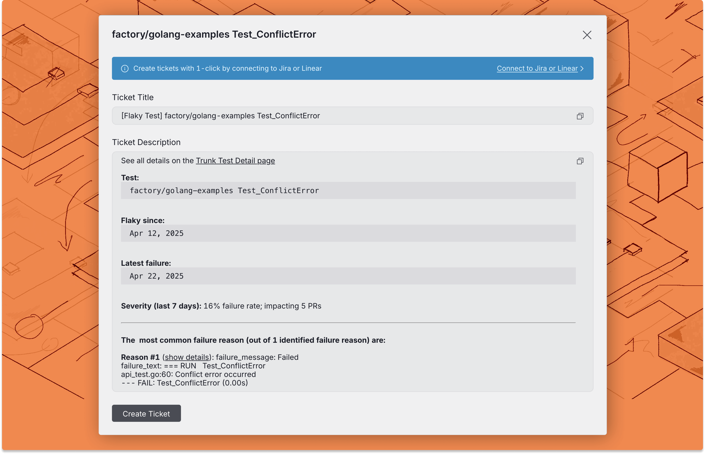
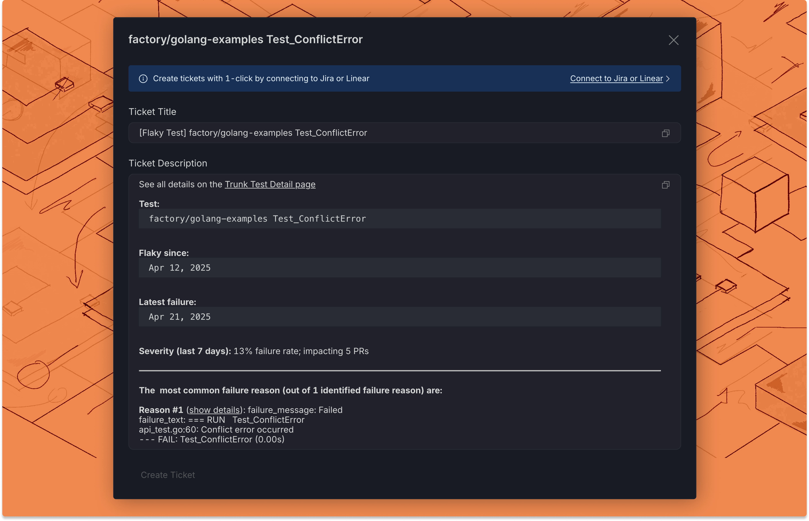

If you have not set up an integration, Trunk Flaky Tests can still generate a ticket title and description so you can copy and paste the details into your project management software.

## Create a new ticket

You can create a new ticket for any test listed in Trunk Flaky Tests.&#x20;

To create one, open the test from your collection's **Tests** tab and click the **Create Ticket** button on its [details page](../../dashboard#test-case-details).

Before you create the ticket, you will have a preview of the title and description.

<Frame>

</Frame>

Now you can copy and paste the ticket title and description into your project management or ticketing platform.
