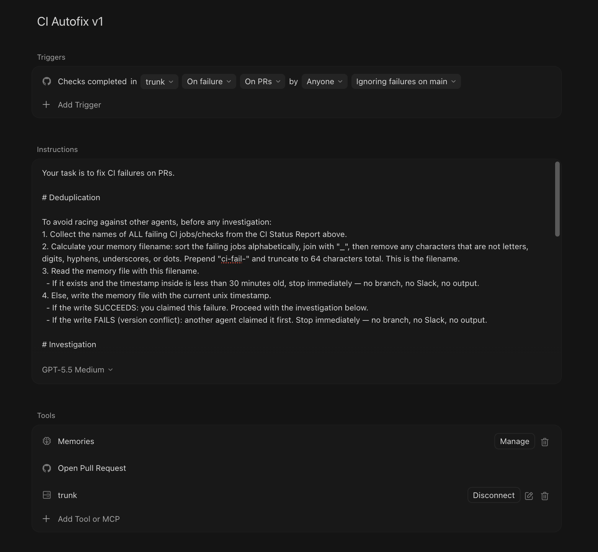

When CI goes red, someone has to read the logs, work out which tests failed and why, and decide whether the change broke them or they're flaky. A coding agent can do that first pass when it gets the failures in a structured form instead of raw logs. Trunk's MCP server provides them: its [`investigate-ci-failure`](../reference/mcp-reference/investigate-ci-failure) tool takes a GitHub Actions run URL and returns each failed test with its error message, leaving out the tests Trunk has quarantined.

This recipe sets up a [Cursor Automation](https://cursor.com/automations) that runs when CI completes, investigates the failure with Trunk, and opens a pull request with the fix. It extends Cursor's **CI Autofix** template.

## Before you begin

- Your repository [uploads test results to Trunk](../get-started/index).
- [Quarantining](../quarantining/) is on, so the agent skips failures from known flaky tests.
- You have your organization API token, from **Settings** → **Developer** → **API Keys**, in the **Organization API token (v1)** section.

## 1. Connect Trunk's MCP server

In Cursor, add Trunk's MCP server as `trunk`, with [bearer authentication](../reference/mcp-reference/configuration/bearer-auth) and your organization API token. A cloud automation can't complete an interactive login, so it needs the token.

## 2. Create the automation

Create an automation from Cursor's **CI Autofix** template, and add the `trunk` MCP server to its actions.

<Frame>

</Frame>

This configuration triggers on a completed CI run, has the agent claim the failure so two runs don't fix it at once, and calls `investigate-ci-failure` with the run's URL. Replace `<repo>` with your repository:

<Accordion title="CI Autofix automation">
```json
{
  "name": "CI Autofix v1",
  "description": "Detect CI failures on main and automatically open PRs",
  "triggers": [
    {
      "git": {
        "ciCompleted": {
          "repos": [
            "https://github.com/<repo>"
          ],
          "condition": 1,
          "ignoreBaseFailures": true
        }
      }
    }
  ],
  "actions": [
    {
      "gitPr": {}
    },
    {
      "mcp": {
        "server": {
          "name": "trunk"
        }
      }
    }
  ],
  "prompts": [
    {
      "prompt": "Your task is to fix CI failures on PRs.\n\n# Deduplication\n\nTo avoid racing against other agents, before any investigation:\n1. Collect the names of ALL failing CI jobs/checks from the CI Status Report above.\n2. Calculate your memory filename: sort the failing jobs alphabetically, join with \"_\", then remove any characters that are not letters, digits, hyphens, underscores, or dots. Prepend \"ci-fail-\" and truncate to 64 characters total. This is the filename.\n3. Read the memory file with this filename.\n  - If it exists and the timestamp inside is less than 30 minutes old, stop immediately — no branch, no Slack, no output.\n4. Else, write the memory file with the current unix timestamp.\n  - If the write SUCCEEDS: you claimed this failure. Proceed with the investigation below.\n  - If the write FAILS (version conflict): another agent claimed it first. Stop immediately — no branch, no Slack, no output.\n\n# Investigation\n\nRoot cause the CI failure. Call investigate-ci-failure on the trunk MCP in order to get information about the failing test by passing in the workflow URL. Use that to identify which tests to fix. Look at the error output returned by this tool. ONLY IF you need additional information, look at the CI run's logs.\n\n- If the CI failure is due to a bug introduced on that commit, create a new PR that fixes the bug. The PR should be stacked on the PR with the failure. Modify/ensure the base branch of the PR you create is the branch of the PR you are fixing.\n- If the CI failure is due to a flaky test, create a new PR that skips that test.\n- If you are not confident in either of these outcomes, then do nothing.\n\n# Output\n\nOutput your results in the following format:\n**CI Autofix Automation**\n\n**Failure logs**: <link to failing CI job>\n**Broken by**: <link to PR> (cc @prAuthor)\n**Reason**: <1-2 sentence explanation of why CI broke>\n**Fixed by**: <1-2 sentence explanation of what fixed it>\n\nMake sure to push the PR but don't include a PR link in your output — the system will generate that for you."
    }
  ],
  "memoryEnabled": true,
  "scope": "team_editable_user",
  "templateId": "ci-autofix"
}
```
</Accordion>

<Note>
Cursor opens the fix with `main` as its base. To merge the fix into the failing pull request instead, change the fix's base branch to that pull request's branch.
</Note>

## 3. Tune the prompt

- Describe your repository's conventions and its common failure patterns, so the agent's fixes match how your team works.
- Keep the agent on `investigate-ci-failure` and off the raw CI logs unless it needs them. The logs cost more time and tokens.
- Put a version in the automation's name, such as `CI Autofix v2`, so you can tell which prompt opened a pull request.

## Related

- [`investigate-ci-failure`](../reference/mcp-reference/investigate-ci-failure). What the MCP tool returns, and its errors.
- [Fix Flaky Tests](./autofix-flaky-tests). Fix a test once Trunk detects it as flaky, rather than when one run fails.
- [Explain a Failed Pull Request](./explain-failed-pr-tests). Tell a pull request's author which failures are probably theirs.
