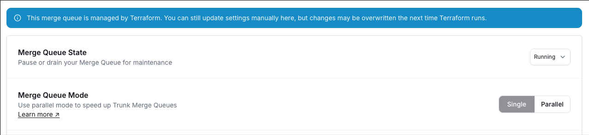
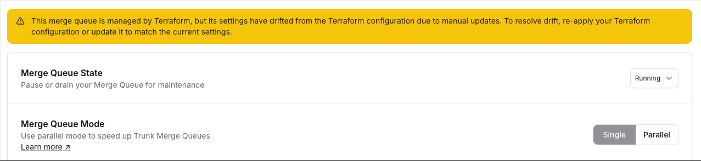

The [trunk-io/trunk](https://registry.terraform.io/providers/trunk-io/trunk/latest) Terraform provider manages merge queues as code with the `trunk_merge_queue` resource. The [Registry documentation](https://registry.terraform.io/providers/trunk-io/trunk/latest/docs/resources/merge_queue) lists every attribute.

**Current version:** `2.0.1`. Upgrading from 1.x? See [Migrate to provider 2.0](./terraform-migrate-to-2).

## Prerequisites

* [Terraform](https://developer.hashicorp.com/terraform/install) >= 1.0
* A Trunk [API key](/api/authentication#create-an-api-key) with the **Update Merge Queue settings** permission, created by an organization admin
* A repository connected to Trunk

## Authentication

Set the API key in the `TRUNK_API_KEY` environment variable:

```bash
export TRUNK_API_KEY="trunk_v2_..."
```

Or pass it in the provider block:

```hcl
provider "trunk" {
  api_key = var.trunk_api_key
}
```

The organization API token (**Organization API token (v1)** under **Settings** → **Developer** → **API Keys**) also works, but uses the v1 API, which will be deprecated soon, and doesn't support `queue_id`, `managed_state`, import by ID, `batching_max_wait_time_minutes = 0`, or updating queues on hosts other than `github.com`, such as GitHub Enterprise.

`base_url` (or `TRUNK_BASE_URL`) sets the API host, `https://api.trunk.io` by default. `api_key` and `base_url` must be known at plan time, so apply anything they depend on first.

<Warning>
Never commit an API key or the organization API token to version control. Use environment variables or a secrets manager.
</Warning>

***

## Quick start

```hcl
terraform {
  required_version = ">= 1.0"

  required_providers {
    trunk = {
      source  = "trunk-io/trunk"
      version = "~> 2.0"
    }
  }
}

provider "trunk" {}

resource "trunk_merge_queue" "main" {
  repo = {
    host  = "github.com"
    owner = "my-org"
    name  = "my-repo"
  }
  target_branch = "main"
  concurrency   = 5
  merge_method  = "squash"
}
```

Run `terraform init`, `terraform plan` and `terraform apply`. If the queue already exists, apply fails with **Merge queue already exists**; [import](#importing-existing-queues) it instead.

***

## What Terraform manages

Only the settings in your configuration; others keep their current value, or Trunk's default for a new queue. Set Slack notifications, [impacted targets from fork PRs](./advanced-settings#impacted-targets-from-fork-prs) and bot approvals (**Settings** → **Organization** → **Bots**) in the Trunk app.

***

## Importing existing queues

Add a `trunk_merge_queue` block for the queue, then import it:

```bash
# By repository and target branch. Branch names may contain slashes.
terraform import trunk_merge_queue.main github.com/my-org/my-repo/main

# Or, with an API key, by the queue's ID.
terraform import trunk_merge_queue.main a3e06cc2-798d-4907-a021-7966dd00b555
```

The ID is the part after `merge-queue/` in the queue's Trunk app URL, or `queue_id` in `terraform state show`. After importing, resolve any differences `terraform plan` shows before you apply.

***

## Resource reference: `trunk_merge_queue`

Values are lowercase, as written below.

### Required attributes

| Attribute | Type | Description |
| --- | --- | --- |
| `repo.host` | string | Repository host, such as `github.com`. |
| `repo.owner` | string | Repository owner or organization. |
| `repo.name` | string | Repository name. |
| `target_branch` | string | Branch the queue merges into, such as `main`. |

Changing any of them replaces the queue.

### Settings

| Attribute | Type | Description |
| --- | --- | --- |
| `mode` | string | `"single"` (default) or `"parallel"`. Parallel mode needs impacted targets uploaded. Changing it starts a [mode switch](#switching-modes). See [Merge Queue mode](./advanced-settings#merge-queue-mode). |
| `state` | string | `"running"` (default), `"paused"`, or `"draining"`. See [Merge Queue state](./advanced-settings#merge-queue-state). |
| `concurrency` | integer | PRs tested at once (minimum 1). See [Testing concurrency](./advanced-settings#testing-concurrency). |
| `testing_timeout_minutes` | integer | Minutes to wait for tests before failing them. `0` means no timeout. See [Timeout for tests to complete](./advanced-settings#timeout-for-tests-to-complete). |
| `pending_failure_depth` | integer | See [Pending failure depth](../optimizations/pending-failure-depth). |
| `can_optimistically_merge` | Boolean | See [optimistic merging](../optimizations/optimistic-merging). |
| `batch` | Boolean | Enable [batching](../optimizations/batching). |
| `batching_min_size` | integer | Target batch size: the most PRs tested in one batch. |
| `batching_max_wait_time_minutes` | integer | Minutes to wait for a batch to fill. `0` doesn't wait, and needs an API key. |
| `bisection_concurrency` | integer | Tests bisection may run at once, separate from `concurrency` (minimum 1). See [Bisection Concurrency](./advanced-settings#bisection-concurrency). |
| `optimization_mode` | string | `"off"` or `"bisection_skip_redundant_tests"`. See [Test caching during bisection](../optimizations/batching#test-caching-during-bisection). |
| `batching_rules` | set of objects | Rules that change how PRs are batched by impacted target. See [Batching rules](#batching-rules). |
| `merge_method` | string | `"merge_commit"`, `"squash"`, or `"rebase"`. See [Merge Method](./advanced-settings#merge-method). |
| `direct_merge_mode` | string | `"off"` or `"always"`. See [Direct merge to main](../optimizations/direct-merge-to-main). |
| `create_prs_for_testing_branches` | Boolean | See [Draft pull request creation](./advanced-settings#draft-pull-request-creation). |
| `test_branch_construction_mode` | string | `"rename_temp_branch"` or `"push_new_branch_from_temp"`. Use the second when a GitHub ruleset on `trunk-temp/` branches blocks renaming them. |
| `comments_enabled` | Boolean | See [GitHub comments](./advanced-settings#github-comments). |
| `commands_enabled` | Boolean | See [GitHub commands](./advanced-settings#github-commands). |
| `status_check_enabled` | Boolean | See [GitHub Statuses](./advanced-settings#github-statuses). |
| `label_commands_enabled` | Boolean | See [Label Commands](./advanced-settings#label-commands). |
| `enqueueing_label` | string | See [Enqueueing label](./advanced-settings#enqueueing-label). |
| `state_labels_enabled` | Boolean | See [State Labels](./advanced-settings#state-labels). |
| `extension_enabled` | Boolean | See [Browser Extension](./advanced-settings#browser-extension). |
| `not_ready_timeout_hours` | integer | Hours a submitted PR may wait to enter the queue before it's cancelled. `0` means no timeout. |
| `required_statuses` | set of strings | Checks that must pass. See [Required statuses](#required-statuses). |

With an API key, an apply above a v2 cap fails, such as `concurrency` over 1000 or `not_ready_timeout_hours` over 720 ([all limits](/api/mergequeues/update-a-merge-queues-configuration)).

### Read-only attributes

| Attribute | Description |
| --- | --- |
| `id` | `{host}/{owner}/{name}/{target_branch}`. |
| `queue_id` | The queue's v2 ID. Null with the organization API token. |
| `managed_state` | `"terraform"` when Terraform made the last change to the queue, `"terraform_with_drift"` when something else changed it since, and `"manual"` when Terraform never has. Null with the organization API token. |

### Required statuses

`required_statuses` overrides `.trunk/trunk.yaml` and branch protection. Leave it out to keep the current override, or set `[]` to remove it. Order doesn't matter.

### Batching rules

```hcl
batching_rules = [
  { target_pattern = "//db/migrations:*", policy = "isolate" },
]
```

`target_pattern` matches an impacted target exactly, or as a prefix when it ends in `*`; `"isolate"` tests a matching PR on its own. Rules apply only in `"parallel"` mode, and `[]` removes them all.

***

## Managing drift

The Trunk app shows a banner on queues Terraform manages.

<Frame caption="Banner for Merge Queue settings showing that the Merge Queue is managed by Terraform.">

</Frame>

Changes made in the app to settings in your configuration show in the next plan, and apply reverts them; changes to other settings are kept.

<Frame caption="Banner for Merge Queue settings showing that the Merge Queue is managed by Terraform but has since drifted due to settings being changed manually in the UI.">

</Frame>

Either way, the queue shows as drifted (`managed_state = "terraform_with_drift"`) until an apply next changes it.

With an API key, once `queue_id` is recorded, Terraform doesn't take over a queue recreated outside it; [import](#importing-existing-queues) the new one.

***

## Switching modes

Changing `mode` drains the queue and switches once it's empty; until then, other changes to the queue fail. To cancel, click **Cancel** next to **Switching to … Mode** in the queue's settings, then set `mode` back.

***

## If creating a queue fails partway

Terraform marks the half-created queue tainted, so the next apply recreates it; run `terraform untaint trunk_merge_queue.<name>` first to keep it instead.

***

## Deleting a queue

Only an empty queue can be deleted: set `state = "draining"`, apply, wait for in-flight PRs to finish, then run `terraform destroy`.

***

## Examples

### High-throughput queue with batching

```hcl
resource "trunk_merge_queue" "main" {
  repo = {
    host  = "github.com"
    owner = "my-org"
    name  = "my-repo"
  }
  target_branch                  = "main"
  mode                           = "parallel"
  concurrency                    = 20
  batch                          = true
  batching_min_size              = 4
  batching_max_wait_time_minutes = 5
  can_optimistically_merge       = true
  batching_rules = [
    { target_pattern = "//db/migrations:*", policy = "isolate" },
  ]
}
```

### Queue with explicit required statuses

```hcl
resource "trunk_merge_queue" "main" {
  repo = {
    host  = "github.com"
    owner = "my-org"
    name  = "my-repo"
  }
  target_branch     = "main"
  concurrency       = 3
  merge_method      = "squash"
  required_statuses = ["ci/test", "ci/build", "ci/lint"]
}
```
