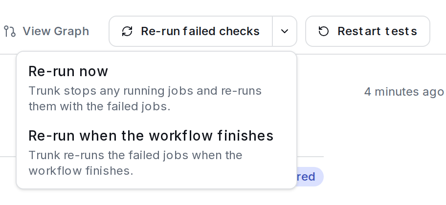
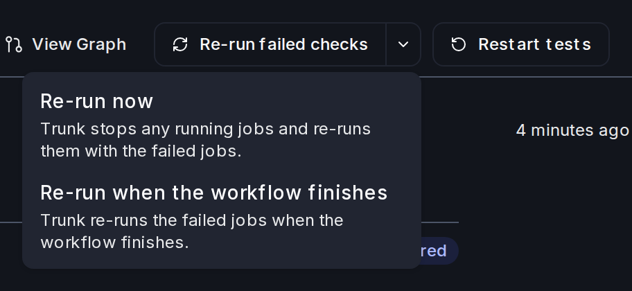
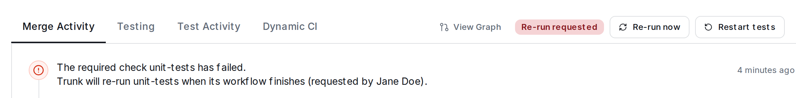
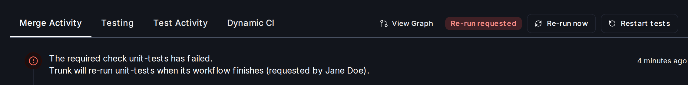
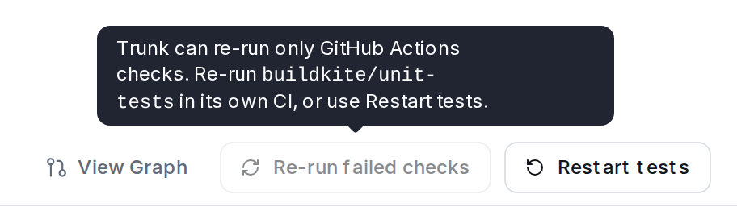
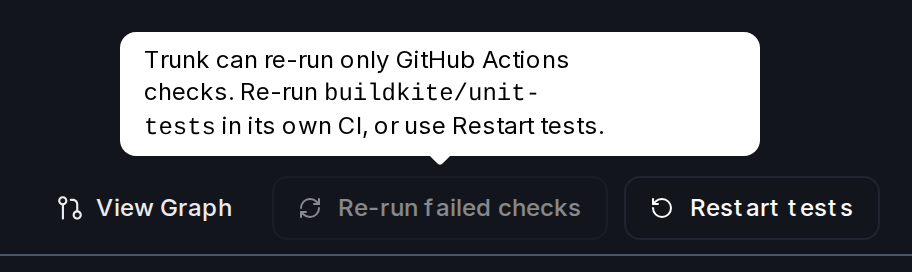

When a required check fails in the queue, re-run the failed checks to test the pull request again without resubmitting it or losing its place in the queue.

## Before you start

* A queue admin turns on **Accept Manual Re-runs of Failed Required Checks** in the queue's [settings](../administration/advanced-settings#accept-manual-re-runs-of-failed-required-checks). It is off by default.
* The pull request must be in **Pending Failure**. With a [Pending Failure Depth](../optimizations/pending-failure-depth) of 0, that is only while a pull request ahead of it is still testing.

## Re-run from Trunk

The button re-runs GitHub Actions jobs in the pull request's repository, and commit statuses that link to a GitHub Actions run.

Open the pull request in Trunk, click **Re-run failed checks**, and confirm. Trunk re-runs the failed jobs and the jobs that depend on them. If a workflow is still running, this also stops its running jobs and re-runs them. To let the workflow finish first, open the menu beside the button and choose **Re-run when the workflow finishes**. You can switch to **Re-run now** later.

<Frame caption="While a workflow is running, the menu beside the button offers both options.">

</Frame>

The pull request shows **Re-run requested** and waits in Pending Failure until the re-run starts or the queue's **Re-run Time Limit** passes (30 minutes by default). Pull requests behind it wait to merge. If the re-run doesn't start in time, or GitHub refuses it, Trunk stops waiting and the pull request's comment says why. The pull request then fails as it would have without the re-run.

<Frame caption="After a request, the pull request shows Re-run requested and the timeline says what Trunk will do.">

</Frame>

You can use the button twice per test run. After that, re-run in your CI or use **Restart tests**.

## Re-run in your CI

You can also re-run the failed checks yourself, such as with **Re-run failed jobs** in GitHub Actions, in any CI that reports to GitHub. Once every failed required check is running again, Trunk tests the pull request again. Nothing keeps it waiting, so start the re-run while it is still in Pending Failure.

## When the button is missing or disabled

The button is missing when the queue doesn't accept re-runs, the pull request isn't in Pending Failure, it failed for a reason other than a required check (such as a timeout), the repository is on GitLab, or you can't submit to the queue. When it's disabled, hover over it to see why:

<Frame caption="A disabled button explains why in its tooltip.">

</Frame>

| Message | What to do |
| --- | --- |
| Trunk can re-run only GitHub Actions checks. Re-run `name` in its own CI, or use Restart tests. | Re-run that check in its CI. |
| These checks were already re-run two times. Use Restart tests. | Re-run in your CI, or use **Restart tests**. |
| These checks cannot be re-run now. Use Restart tests. | Trunk didn't keep this test run, for example because re-runs were turned on after it failed. Use **Restart tests**. |

## Using the API

Send `POST /v2/pull-requests/{id}/rerun-failed-checks` with `{"mode": "now"}` or `{"mode": "wait"}` ([reference](/api/pullrequests/re-run-a-pull-requests-failed-checks)). It needs the **Merge and cancel PRs** permission. Turn the feature on with `failedTestRunTeardown: "keepForRerun"`, and set the time limit with `maxHoldMinutes`, on [`PATCH /v2/merge-queues/{id}/config`](/api/mergequeues/update-a-merge-queues-configuration).
