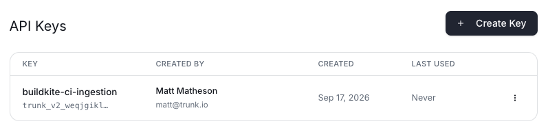

[Evergreen](https://github.com/evergreen-ci/evergreen) sends a webhook when a task or a version finishes. To set up Trunk CI, add two webhook subscriptions that send these events to Trunk's ingest endpoint.

Trunk maps Evergreen to its CI model like this:

| Evergreen | Trunk |
| --- | --- |
| Project | Pipeline |
| Version (a commit, a patch or a pull request, for each build initiator you subscribe to) | Pipeline run |
| Task (with its build variant) | Job |
| Task execution | Job attempt |

#### Create a Trunk API key

An organization admin creates the key. In the Trunk app, go to [**Settings** → **Developer** → **API Keys**](https://app.trunk.io/settings/developer/api-tokens) and click **Create Key**. Use an API key. The organization API token shown on the same page also works, but you cannot revoke it without changing it everywhere it is used.

#### Add the webhook subscriptions

Add the subscriptions in your Evergreen **repo settings** if you can. A repo-level subscription applies to every branch project attached to the repo, including branches you add later. You can also add them to each project instead. Do not add them in both places: Evergreen then sends each webhook twice.

In Evergreen, open the repo or project settings, select the **Notifications** tab and click **Add Subscription**. Add two subscriptions for each build initiator you want in Trunk:

| Event | Build Initiator | Notification Method |
| --- | --- | --- |
| **Any task finishes** | One of the values below | **Webhook** |
| **Any version finishes** | The same value | **Webhook** |

The **Build Initiator** field takes one value per subscription, and its default is **Commit**. Evergreen sends only the versions and tasks of that initiator. To send pull requests too, add a second pair with **Pull Request**, and so on:

| Build Initiator | Versions sent |
| --- | --- |
| **Commit** | Commits on the tracked branch |
| **Pull Request** | GitHub pull request patches |
| **Patch** | Patches submitted with `evergreen patch` |
| **Periodic Build** | Periodic builds |

Give every subscription the same webhook settings:

| Field | Value |
| --- | --- |
| **Webhook URL** | `https://api.trunk.io/v2/ci/evergreen/v1/webhooks` |
| **Webhook Secret** | Leave it empty. Evergreen makes one when you save. |
| **Retry count** | `3` |
| **Max timeout (ms)** | `30000` |
| **HTTP Headers** | Key `Authorization`, Value `Bearer <your Trunk API key>` |

Evergreen stores the `Authorization` header as a secret and does not show it again after you save.

Do not add the "fails", "first failure", "previously passing" or "runtime" events. Each one sends a subset of what **Any task finishes** and **Any version finishes** already send, so Trunk would receive the same data twice.

## Troubleshooting

**Nothing arrives at all.** The endpoint answers `403` for a request without the `Authorization: Bearer <key>` header, and `401` for an API key it does not recognize. Check the header first, then the repository name match below.

**Only some versions arrive.** Each subscription sends one build initiator. Add a pair of subscriptions for each initiator you want, as described in [Add the webhook subscriptions](#add-the-webhook-subscriptions).

**Versions arrive for one repository but not another.** Each version is matched to a Trunk repository by its repository name. Confirm that a repository with that name exists in your Trunk organization. If two repositories in your organization have the same name under different owners, Trunk cannot choose one and skips the version.

**A large task is refused.** The endpoint accepts webhook bodies up to 16 MiB and answers `413` for larger ones.

**Evergreen reports `503`.** Trunk asks Evergreen to send the webhook again later. Evergreen retries a non-`2xx` answer up to the number of retries you set.

A few Evergreen specifics are worth knowing:

- **A display task is one job.** Evergreen sends one "task finishes" webhook for a display task, not one for each of its execution tasks, so Trunk shows the display task as one job.
- **A restart is a new attempt.** When Evergreen restarts a task, it runs a new execution of the same task, and Trunk records it as the next attempt of that job.
- **Stepback runs arrive late.** When Evergreen activates a task on an older commit to find a failure, that run is reported on the older version.
